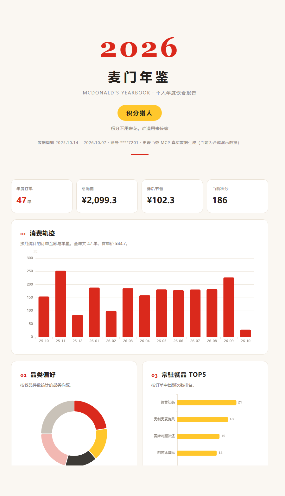

# 麦门年鉴 mcd-yearbook

> 基于麦当劳中国 MCP 的个人年度饮食报告生成器 —— 把订单、积分、优惠券、抽奖、活动日历聚成一份可以晒的年度报告。



[完整 demo 报告（单文件 HTML，可直接下载打开）](docs/demo-report.html) · [麦当劳程序员创意开发大赛参赛作品](#参赛信息)

## 它是什么

麦门年鉴拉取你在麦当劳的真实数据，自动生成一份杂志排版的年度报告：

- 你的**年度称号**（积分猎人 / 汉堡鉴赏家 / 早餐信徒 / 欧皇本皇……由数据算出，规则透明可复现）
- 消费轨迹、品类偏好、常驻餐品 TOP5、24 小时麦门作息
- 热量成就：用官方营养数据逐项换算，告诉你这一年相当于吃了多少个巨无霸
- 省钱战绩、积分流水、抽奖幸运时刻、营销活动足迹
- 一张适合截图分享的年度分享卡

报告是**完全自包含的单文件 HTML**（ECharts 已内联），断网可开，直接扔给朋友就能看。

## 快速开始

需要 Node.js >= 18，零第三方依赖。

```bash
git clone https://github.com/EldonQ/sparkEat.git
cd sparkEat

# 方式一：合成演示数据，免 Token，秒开
node bin/mcd-yearbook.mjs --demo --out my-yearbook.html --md

# 方式二：真实数据（先到 https://open.mcd.cn/mcp 申请 MCP Token）
node bin/mcd-yearbook.mjs --token $MCD_MCP_TOKEN --out my-yearbook.html --md

# 方式三：在 WorkBuddy 里作为 Skill 使用（见 SKILL.md）
node bin/mcd-yearbook.mjs --data mcd-raw.json --out my-yearbook.html --md
```

用浏览器打开生成的 `my-yearbook.html` 即可。

## 作为 WorkBuddy Skill 使用

本仓库同时是一个可安装的 WorkBuddy Skill（见 [SKILL.md](SKILL.md)）。在 WorkBuddy 中对 AI 说：

> 帮我生成麦门年鉴

AI 会依次调用 8 个麦当劳 MCP **只读**工具采集数据，生成报告并用几句话总结你的年度称号和最亮眼的数据。

Skill 安装：

```bash
git clone https://github.com/EldonQ/sparkEat.git ~/.workbuddy/skills/mcd-yearbook
```

## 数据从哪里来

全部来自[麦当劳中国 MCP Server](https://github.com/M-China/mcd-mcp-server)（`https://mcp.mcd.cn`，Streamable HTTP）的 8 个**只读**工具：

| 工具 | 贡献的报告章节 |
|---|---|
| `order-list` | 消费轨迹、品类偏好、常驻餐品、麦门作息 |
| `list-nutrition-foods` | 热量成就（官方营养表逐项换算） |
| `query-my-account` | 积分流水 |
| `query-my-coupons` / `available-coupons` | 省钱战绩 |
| `query-my-prizes` / `query-lottery-info` | 幸运时刻 |
| `campaign-calendar` | 活动足迹 |

**项目只调用只读工具**：不创建订单、不领券、不抽奖，运行过程零资金风险。详细的调用流程、返回格式处理与错误码见 [MCP_INTEGRATION.md](MCP_INTEGRATION.md)。

## 实现要点

- **零依赖**：纯 Node.js（>= 18），MCP 客户端是自己实现的 Streamable HTTP JSON-RPC 握手（initialize → initialized → tools/call），约 120 行
- **多格式归一化**：实测麦当劳 MCP 的返回有 JSON、Markdown、类 CSV 文本三种形态，数据层分别解析（订单还会拆套餐子项 `comboItemList` 精确到单品）
- **三条数据通路**：`--demo`（合成数据）/ `--token`（直连 MCP）/ `--data`（Skill 场景下 AI 代采）
- **离线自包含**：ECharts 内联进 HTML，报告不依赖任何 CDN
- **测试**：8 项冒烟测试（`npm test`），覆盖解析、聚合、人格、渲染与空数据边界

## 项目结构

```
├── bin/mcd-yearbook.mjs    CLI 入口
├── src/
│   ├── mcp-client.mjs      MCP Streamable HTTP 客户端
│   ├── collect.mjs         三通路数据采集与归一化
│   ├── aggregate.mjs       八维统计聚合引擎
│   ├── persona.mjs         麦门称号算法
│   └── render.mjs          ECharts 年报渲染器
├── scripts/make-fixture.mjs 合成演示数据生成器（确定性种子）
├── fixtures/               演示数据 + 官方营养表
├── web/echarts.min.js      内联用 ECharts 5.5.1
├── test/smoke.mjs          冒烟测试
├── docs/demo-report.html   合成数据完整 demo
└── SKILL.md                WorkBuddy Skill 定义
```

## 数据与隐私

- 只读采集，不落库不上传，报告仅在本地生成
- 账号 ID 在报告中脱敏为 `****后4位`
- 仓库内只有环境变量占位符配置（`mcp-config.example.json`），无任何真实 Token
- `fixtures/` 为合成数据，不含真实用户信息

## 参赛信息

麦当劳程序员创意开发大赛（2026 程序员节专场）参赛作品。

- 必交文件：[README.md](README.md) · [CONTEST_DECLARATION.md](CONTEST_DECLARATION.md) · [MCP_INTEGRATION.md](MCP_INTEGRATION.md) · [mcp-config.example.json](mcp-config.example.json) · [workbuddy.md](workbuddy.md)
- 开发过程（WorkBuddy 协作上下文）：[workbuddy.md](workbuddy.md)
- 本项目为参赛作品，非麦当劳官方产品；报告输出仅供参考，餐品信息、价格及供应状态以麦当劳官方渠道实时结果为准。

## License

MIT
